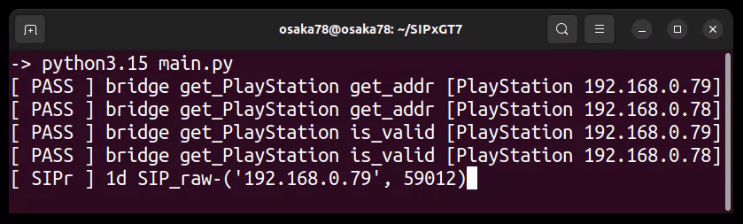

# WIP
# SIPxGT7
## SIPxGT7 takes raw 'Simulator Interface Packet GT7 ver 0.0' and writes it to file.





### User Configuration
Add your PlayStation(s) to `config.py`

### Use
1. Run main.py in terminal
```
python3.15 main.py   
```

2. CLI will notify you what it's doing and report status

3. SIPxGT7 writes SIP raw packet to `SIP_raw` file.

4. Ctrl+C to stop SIPxGT7.

### Minimum Requirements
PlayStation, GT7 and SIPxGT7 on same LAN

(Tested on GT7 1.72, PS4, PS5, Ubuntu22, Python3.15)

## Milestone: 
Write SIP from multiple Playstations

